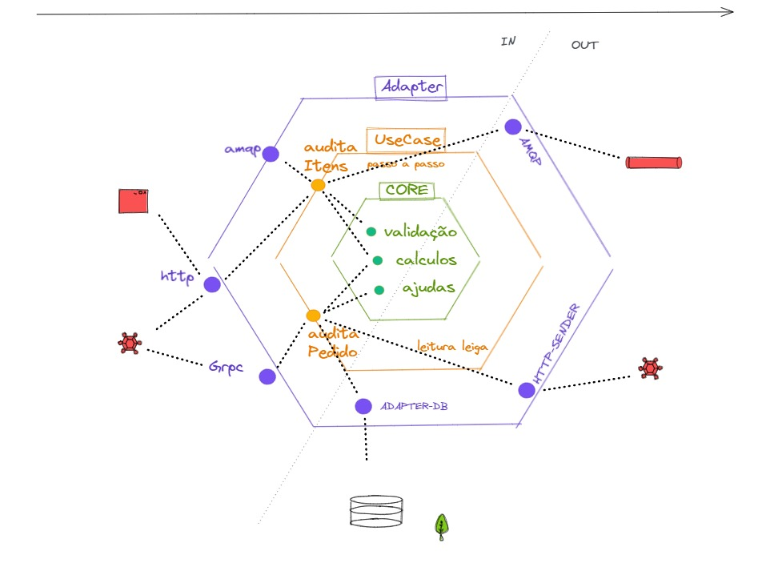

# Registro de productos en masa

API NestJS para registrar y consultar productos en masa. El bounded context es el **Catálogo**: alta y consulta paginada de productos.

Regla principal: **si cualquier ítem de la masa falla en la validación o en la persistencia, no se guarda ningún producto** (todo o nada). El ítem inválido se indica en la respuesta.

## Tecnologías

- NestJS
- Sequelize
- PostgreSQL

## Cómo ejecutar

```bash
cp .env.example .env
docker compose up -d
npm install
npm run start:dev
```

Variables de entorno (sin credenciales en el código): `PORT`, `DB_HOST`, `DB_PORT`, `DB_USERNAME`, `DB_PASSWORD`, `DB_NAME`.

```bash
npm test    # unitários de domínio e casos de uso (sem banco)
npm run build
```

## API

`POST /produtos` — multipart, campo `file` con un JSON array:

```json
[
  {
    "key": "p-1",
    "data_preco": "2026-01-10",
    "cod_produto": 100,
    "sku": "SKU-01",
    "qtd_estoque": 5,
    "desconto": 10,
    "data_hora_insercao": "2026-01-10T10:00:00.000Z",
    "data_inicio": "2026-01-01",
    "data_fim": "2026-12-31"
  }
]
```

La validación de dominio responde **422** con el índice del ítem. Un JSON malformado o un archivo ausente responde **400**. Éxito: `{ "message": "Produtos cadastrados com sucesso" }`.

`GET /produtos?page=1&limit=10` — paginación 1-based. `offset = (page - 1) * limit`. `limit` entre 1 y 100.

`GET /` — healthcheck.

## Arquitectura



Capas del **Catálogo**, de adentro hacia afuera:

```
domínio  →  aplicação (ports + use cases)  →  infraestrutura (adapters)
```

La infraestructura depende del dominio. El dominio no conoce NestJS, Sequelize ni HTTP.


*Diagrama del diseño actual: el dominio queda en el centro y las dependencias apuntan hacia adentro. La infraestructura implementa los puertos; el dominio no conoce NestJS ni Sequelize.*

| Capa | Qué entra | Qué no entra |
| --- | --- | --- |
| **Dominio** | Agregado `Produto`, VOs, invariantes, `ErroDeValidacao` | NestJS, Sequelize, status HTTP |
| **Aplicación** | Casos de uso y ports (`ProdutoRepository`, `UnitOfWork`) | Tipo `Transaction` de Sequelize, `HttpException` |
| **Infraestructura** | Controller HTTP, filter, repositorio Sequelize, UoW, logger | Regla de negocio |

**Ports y adapters:** los casos de uso reciben interfaces. El `AppModule` inyecta las implementaciones Sequelize. Los tests unitarios usan fakes en memoria en lugar de esos adapters.

**Agregado `Produto`:** se crea solo si pasan las invariantes (código positivo, stock ≥ 0, SKU, descuento 0–100, período válido). Comportamiento: `estaVigente()`, `temEstoque()`.

**Value objects:** `Sku` (normaliza y valida el formato), `Desconto` (0–100) y `PeriodoVigencia` (`data_inicio`/`data_fim`, fin ≥ inicio).

**Todo o nada:** el caso de uso valida la masa entera *antes* de tocar la base (y rechaza SKU duplicado). Recién ahí `UnitOfWork.execute` abre una transacción, persiste los lotes (10.000 ítems) y Sequelize hace commit. Cualquier excepción dispara rollback: el repositorio **no** traga el error de `bulkCreate`.

Los logs de request y de error quedan en el adapter HTTP (`logs/`).
